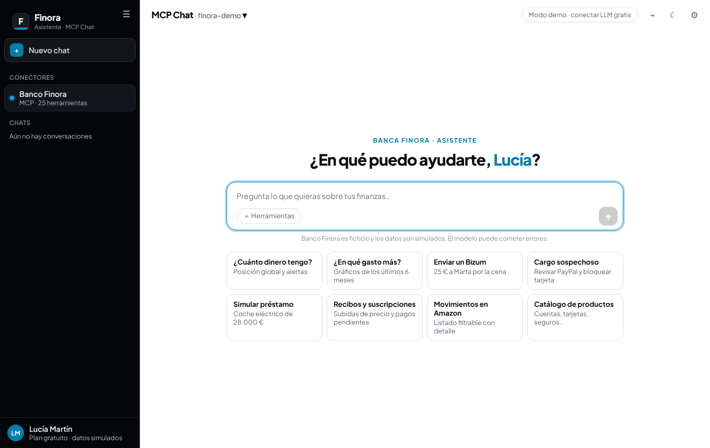
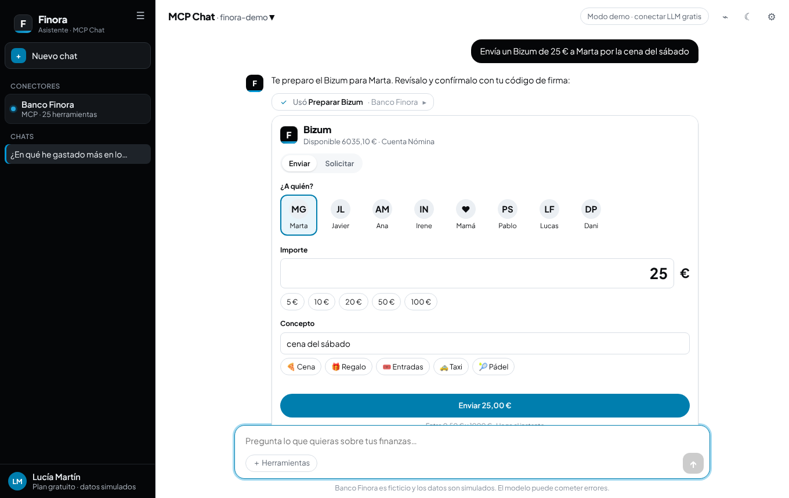
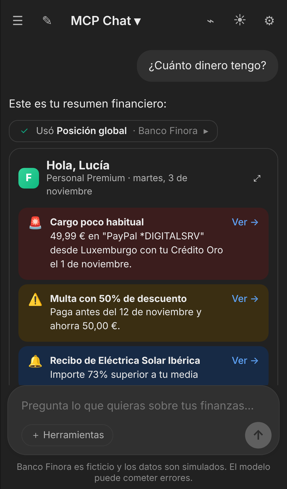

# MCP Chat · Banco Finora

Un clon de ChatGPT/Claude construido sobre **[MCP Apps](https://modelcontextprotocol.io/extensions/apps/overview)**
y un servidor MCP de banca personal (**Banco Finora**, ficticio) que pinta widgets interactivos dentro de la
conversación: gráficos, formularios, selectores, listados, tarjetas, alertas… y que puede **lanzar operativa**
(Bizum, transferencias, pagos, bloqueo de tarjetas, contratación) siempre con confirmación y firma de la usuaria.

Funciona con **LLMs gratuitos** (Groq, Google Gemini, OpenRouter `:free`, Ollama local) o, sin ninguna clave,
con un **modo demo** que simula el LLM con reglas.

| Escritorio | Bizum en el chat | Móvil (oscuro) |
|---|---|---|
|  |  |  |

## Arrancar (lanzadera)

**Opción 1 · Doble clic en tu ordenador** (necesitas [Node.js](https://nodejs.org) 20+):

| Sistema | Archivo (en la raíz del repo) |
|---|---|
| Mac | `Abrir MCP Chat.command` (si avisa de "desarrollador no identificado": clic derecho → Abrir) |
| Windows | `Abrir MCP Chat.bat` |
| Linux | `./abrir-mcp-chat.sh` |

La lanzadera instala dependencias la primera vez, compila, te pregunta si quieres conectar un LLM gratuito
(Groq / Gemini / OpenRouter, o Enter para modo demo), busca un puerto libre y abre el navegador.
Equivale a `cd mcp-chat && npm run lanzar`.

**Opción 2 · En el navegador o el móvil, sin instalar nada (GitHub Codespaces):**

[](https://codespaces.new/fernandezeva-lgtm/Test?ref=ccr-98029570-sgtshm&devcontainer_path=.devcontainer/mcp-chat/devcontainer.json)

Pulsa **Create codespace**; en 2-3 minutos se abre la app. Para usar un LLM real, crea el secreto
`GROQ_API_KEY` (o `GEMINI_API_KEY`) en GitHub → Settings → Codespaces → Secrets, o pégalo en ⚙︎ Ajustes.

**Opción 3 · Terminal:**

```bash
cd mcp-chat
npm install
npm start          # compila y abre en http://localhost:8787
```

Prueba: *“¿Cuánto dinero tengo?”*, *“¿En qué gasto más?”*, *“Envía 25 € a Marta por Bizum”*,
*“Veo un cargo raro de PayPal”*, *“Simula un préstamo de coche de 28.000 €”*…
En la demo, el código de firma (OTP) es cualquier número de 6 dígitos (`000000` simula un error).

Para desarrollo con recarga en caliente: `npm run dev` y abre http://localhost:5173.

### Conectar un LLM gratuito

Desde la app: **⚙︎ Ajustes → Modelo de lenguaje**, elige proveedor y pega la clave (se guarda solo en tu navegador).
O en el servidor, copiando `.env.example` a `.env`:

| Proveedor | Variable | Dónde conseguir la clave | Modelo por defecto |
|---|---|---|---|
| Groq | `GROQ_API_KEY` | https://console.groq.com/keys | `openai/gpt-oss-120b` |
| Google Gemini | `GEMINI_API_KEY` | https://aistudio.google.com/apikey | `gemini-2.5-flash` |
| OpenRouter | `OPENROUTER_API_KEY` | https://openrouter.ai/keys | `openai/gpt-oss-20b:free` |
| Ollama (local) | `OLLAMA_BASE_URL` | https://ollama.com | `qwen2.5:7b` |
| Cualquier API compatible con OpenAI | `OPENAI_COMPAT_BASE_URL` (+ `_API_KEY`, `_MODEL`) | — | — |

La lista de modelos se consulta en vivo al proveedor (`/models`), así que puedes elegir cualquiera que soporte *tool calling*.

## Arquitectura

```
┌──────────────────────── Navegador: MCP Chat (host) ────────────────────────┐
│  React · historial, streaming, selector de modelo, inspector MCP Apps      │
│  ├─ Cliente MCP (Streamable HTTP) ──────────────────────────┐              │
│  ├─ Bucle agéntico: LLM ⇄ tools/call                        │              │
│  └─ Por cada tool con _meta.ui.resourceUri:                 │              │
│       iframe sandbox (srcdoc + CSP) ⇄ AppBridge ⇄ host      │              │
└──────────────┬──────────────────────────────────────────────┼──────────────┘
               │ /api/llm/chat (NDJSON)                       │ /mcp
┌──────────────▼───────────── Backend Node (Hono) ────────────▼──────────────┐
│  Proxy LLM: Groq · Gemini · OpenRouter · Ollama · demo   Servidor MCP Finora│
│  (las claves nunca llegan a los widgets)                 25 tools · 13 ui://│
└────────────────────────────────────────────────────────────────────────────┘
```

```
src/
  bank/            Servidor MCP "Banco Finora"
    generator.ts   2 años de movimientos realistas (determinista), cuentas, tarjetas, préstamos…
    bank.ts        "Core banking" en memoria: consultas y operativa (con OTP simulado)
    catalog.ts     Catálogo de productos y FAQs
    server.ts      Tools + recursos ui:// (registerAppTool / registerAppResource)
    stdio.ts       Entrada stdio para Claude Desktop, VS Code…
  widgets/         Las MCP Apps (vistas). Cada .ts → dist/widgets/<nombre>.html autocontenido
    lib/runtime.ts App SDK oficial (@modelcontextprotocol/ext-apps), tema del host, helpers
    lib/charts.ts  Gráficos SVG sin dependencias (donut, barras, líneas, anillos, sparklines)
  backend/         HTTP: /mcp, /api/llm/*, estáticos · llm.ts (proveedores) · demo.ts (LLM simulado)
  web/             El host tipo ChatGPT (React + Vite) · WidgetFrame.tsx = AppBridge
```

### El servidor MCP

| Herramienta (visible para el modelo) | Widget | Qué pinta |
|---|---|---|
| `posicion_global` | `ui://finora/posicion.html` | KPIs, banners de alertas, cuentas, tarjetas, préstamo, inversiones, evolución 12 meses |
| `ver_movimientos` | `ui://finora/movimientos.html` | Listado agrupado por día, buscador, filtros (cuenta, categoría, tipo, fechas), detalle, CSV |
| `analizar_gastos` | `ui://finora/analisis.html` | Selector de periodo, donut por categoría, barras ingresos/gastos, top comercios, análisis IA |
| `recibos_y_pagos` | `ui://finora/recibos.html` | Pagos pendientes (multa con descuento…), recibos con sparkline, suscripciones con subidas |
| `gestionar_tarjetas` | `ui://finora/tarjetas.html` | Tarjeta visual, interruptores (bloqueo, online, extranjero, contactless), límites, ver PIN |
| `enviar_bizum` | `ui://finora/bizum.html` | Selector de contactos, importe, concepto, enviar/solicitar, firma OTP |
| `nueva_transferencia` | `ui://finora/transferencia.html` | Beneficiarios, IBAN nuevo con validación, inmediata/programada, firma OTP |
| `simular_prestamo` | `ui://finora/simulador.html` | Sliders importe/plazo, cuota, endeudamiento, cuadro de amortización, solicitar |
| `catalogo_productos` | `ui://finora/catalogo.html` | Tarjetas de producto con banderas (Nuevo, Oferta, Recomendado), condiciones, contratar |
| `objetivos_ahorro` | `ui://finora/objetivos.html` | Anillos de progreso, aportar, crear objetivo |
| `mis_inversiones` | `ui://finora/inversiones.html` | Evolución de la cartera, reparto, rentabilidad y riesgo |
| `mi_perfil` | `ui://finora/perfil.html` | Datos personales editables (con firma), preferencias, productos, certificado |
| `centro_ayuda` | `ui://finora/ayuda.html` | Buscador de FAQs, acordeón, gestor, formulario de consulta |
| `buscar_movimientos` | — | Datos en texto, sin widget |

Las **operaciones con dinero** (`confirmar_bizum`, `confirmar_transferencia`, `pagar_pendiente`, `actualizar_tarjeta`,
`devolver_recibo`, `solicitar_producto`, `actualizar_perfil`, `aportar_objetivo`, `crear_consulta`…) se registran con
`_meta.ui.visibility: ["app"]`: **el modelo no puede ejecutarlas**, solo prepararlas; las dispara el widget cuando la
usuaria confirma y firma. Además el servidor expone 6 **prompts** que el host muestra como sugerencias.

Datos de la clienta: perfil completo, 2 cuentas, 3 tarjetas, hipoteca, fondo y plan de pensiones, 2 seguros,
~1.000 movimientos en 2 años (nóminas, recibos con estacionalidad, supermercado, viajes, Bizums…), recibos con
alertas (subida de Netflix, luz anómala), pagos pendientes, contactos, beneficiarios y objetivos de ahorro.
Todo está en memoria: reinícialo desde Ajustes o con la herramienta `reiniciar_demo`.

### Capacidades de MCP Apps que usa el host

| Capacidad | Dónde se ve |
|---|---|
| `ui/initialize` con `hostContext` (tema, variables CSS, idioma, zona horaria, dimensiones, `toolInfo`) | Todos los widgets heredan colores y modo oscuro del chat |
| `ui/notifications/tool-input` / `tool-result` / `tool-cancelled` | Formularios prerrellenados con lo que entendió el modelo |
| `tools/call` desde la vista (con control de visibilidad) | Filtros, cambio de periodo, firmar operaciones |
| `ui/message` | “Preguntar al asistente”, “Ver →” en alertas, “¿Me conviene?” |
| `ui/update-model-context` | El modelo sabe qué filtró la usuaria o qué operación firmó (ver inspector ⌁) |
| `sampling/createMessage` | “✨ Análisis con IA” del widget de gastos usa el LLM del chat |
| `ui/request-display-mode` (inline / fullscreen / pip) | Botones ⤢ y ▣ |
| `ui/notifications/size-changed` | Altura automática del iframe |
| `ui/download-file` | CSV de movimientos, certificado de titularidad |
| `ui/open-link` | Llamar o escribir al gestor (con confirmación) |
| `notifications/message`, `ui/resource-teardown`, `request-teardown` | Logs y ciclo de vida |

Seguridad de los widgets: cada vista corre en un `iframe` con `sandbox="allow-scripts allow-forms allow-popups"`
(sin `allow-same-origin`, origen opaco) y con una CSP inyectada a partir de `_meta.ui.csp` (por defecto, sin red).

### Usar el servidor desde otros clientes

El servidor es un MCP estándar, así que sus widgets también funcionan en clientes compatibles con MCP Apps
(Claude, ChatGPT, VS Code, Goose, MCPJam…):

- **HTTP**: `http://localhost:8787/mcp` (para clientes en la nube, expónlo con un túnel como `cloudflared` o `ngrok`).
- **stdio** (Claude Desktop):
  ```json
  { "mcpServers": { "finora": { "command": "npx", "args": ["tsx", "/ruta/a/Test/mcp-chat/src/bank/stdio.ts"] } } }
  ```
  (antes ejecuta `npm run build:widgets` una vez).

## Scripts

| Comando | Qué hace |
|---|---|
| `npm run lanzar` | Lanzadera: instala, compila si hace falta, configura LLM y abre el navegador |
| `npm start` | Compila widgets y web y sirve todo en `:8787` |
| `npm run dev` | Widgets en modo watch + backend con recarga + Vite en `:5173` |
| `npm run build` | Compila `dist/widgets/*.html` y `dist/web` |
| `npm run mcp:stdio` | Servidor MCP por stdio |
| `npm run typecheck` | Comprobación de tipos |
| `npm run test:e2e` | Prueba de extremo a extremo con Playwright y el LLM demo (con `npm start` corriendo) |
